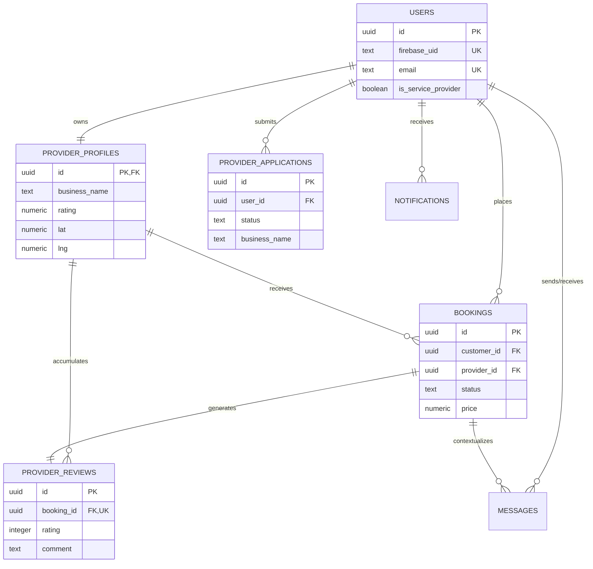

# 4. Database Design

## 4.1 Introduction
The database for QuickFix is built on **Supabase (PostgreSQL)**. It leverages a relational structure to ensure data consistency, enforce business logic through constraints and triggers, and provide secure data access using Row Level Security (RLS). The schema is designed to handle multi-role users (Customers, Providers, Admins) and complex transactional lifecycles for service bookings.

## 4.2 Purpose and Scope
This design document serves as a comprehensive data dictionary and architectural map for the system's storage layer. It covers:
*   **User Identity:** Integration with Firebase Auth and role management.
*   **Provider Ecosystem:** Vetting applications, business profiles, and service listings.
*   **Transactional Engine:** Bookings, payments, and real-time status tracking.
*   **Engagement:** Real-time messaging, reviews, and push notification logging.

## 4.3 Detailed Data Dictionary

### 4.3.1 Users (`public.users`)
This table manages the core identity and global settings for every person registered on the platform.
| Column | Data Type | Constraints | Description |
| :--- | :--- | :--- | :--- |
| `id` | UUID | PK, Default: gen_random_uuid() | Internal unique identifier for the user. |
| `firebase_uid` | Text | Unique, Not Null | Links to the unique ID generated by Firebase Auth. |
| `name` | Text | Not Null | User's full name or business owner's name. |
| `email` | Text | Unique, Not Null | Registered email address. |
| `phone` | Text | | Contact phone number. |
| `is_user` | Boolean | Default: true | Access flag for customer features. |
| `is_service_provider`| Boolean | Default: false | Access flag for the provider dashboard. |
| `is_admin` | Boolean | Default: false | Access flag for administrative tools. |
| `fcm_token` | Text | | Token for Firebase Cloud Messaging. |
| `profile_image` | Text | | Path to the profile picture in storage. |
| `dark_mode` | Boolean | Default: false | User preference for app theme. |
| `language` | Text | Default: 'en' | User preference for app language. |
| `created_at` | Timestamptz | Default: now() | Timestamp of account registration. |
| `deleted_at` | Timestamptz | | Timestamp for account soft-deletion. |

### 4.3.2 Provider Applications (`public.provider_applications`)
Staging table used for the verification and onboarding of new service providers.
| Column | Data Type | Constraints | Description |
| :--- | :--- | :--- | :--- |
| `id` | UUID | Primary Key | Unique ID for the onboarding request. |
| `user_id` | UUID | Foreign Key (users.id) | Applicant's internal user reference. |
| `firebase_uid` | Text | | Applicant's Firebase UID reference. |
| `owner_name` | Text | Not Null | Legal name of the business owner. |
| `business_name` | Text | Not Null | Trade name of the business. |
| `category` | Text | Not Null | Industry category (e.g., Plumbing). |
| `experience_yrs` | Integer | | Total years of professional experience. |
| `city` | Text | Not Null | Operating city for the business. |
| `address` | Text | | Detailed business location. |
| `business_image_url`| Text | | Storage path for the business storefront. |
| `id_proof_url` | Text | | Storage path for the identity verification document. |
| `status` | Text | Default: 'pending' | `pending`, `approved`, or `rejected`. |
| `rejection_reason` | Text | | Feedback from admin if the app is denied. |
| `submitted_at` | Timestamptz | Default: now() | Date of submission. |
| `reviewed_at` | Timestamptz | | Date of admin review. |
| `reviewed_by_uid` | Text | | Admin UID who processed the application. |

### 4.3.3 Provider Profiles (`public.provider_profiles`)
Verified business data that is searchable by customers.
| Column | Data Type | Constraints | Description |
| :--- | :--- | :--- | :--- |
| `id` | UUID | PK, FK (users.id) | Matches User ID (one-to-one). |
| `business_name` | Text | Not Null | Name shown in search results. |
| `category` | Text | Not Null | Tag used for filtering by service type. |
| `description` | Text | | Detailed bio and services offered. |
| `city` | Text | Not Null | Primary city of operation. |
| `area` | Text | | Specific locality or zone. |
| `lat` | Numeric | | Latitude for distance calculations. |
| `lng` | Numeric | | Longitude for distance calculations. |
| `rating` | Numeric(2,1) | Default: 0 | Average rating (synced via trigger). |
| `review_count` | Integer | Default: 0 | Total reviews received (synced via trigger). |
| `is_approved` | Boolean | Default: false | Global toggle for search visibility. |
| `availability_status`| Text | Default: 'Available' | Status: `Available`, `Busy`, or `Offline`. |

### 4.3.4 Bookings (`public.bookings`)
Transactional history tracking all service requests and their lifecycle.
| Column | Data Type | Constraints | Description |
| :--- | :--- | :--- | :--- |
| `id` | UUID | Primary Key | Unique booking reference ID. |
| `customer_id` | Text/UUID | Foreign Key (users.id) | Customer who made the booking. |
| `provider_id` | Text/UUID | Foreign Key (provider_profiles.id)| Assigned service provider. |
| `service_name` | Text | Not Null | Name of the service requested. |
| `category` | Text | | Contextual category. |
| `booking_date` | Date | Not Null | Scheduled date for the service. |
| `booking_time` | Text | | Scheduled time slot. |
| `status` | Text | Default: 'pending' | `pending`, `accepted`, `completed`, `cancelled`. |
| `price` | Numeric | | Final agreed price for the service. |
| `payment_status` | Text | Default: 'unpaid' | `unpaid`, `paid`, or `failed`. |
| `payment_id` | Text | | Razorpay Transaction reference. |
| `is_emergency` | Boolean | Default: false | Emergency priority flag. |
| `address` | Text | | Visit location address. |
| `city` | Text | | City where service is performed. |
| `description` | Text | | Additional notes from the customer. |
| `created_at` | Timestamptz | Default: now() | Record creation timestamp. |
| `completed_at` | Timestamptz | | Job completion timestamp. |

### 4.3.5 Provider Reviews (`public.provider_reviews`)
| Column | Data Type | Constraints | Description |
| :--- | :--- | :--- | :--- |
| `id` | UUID | Primary Key | Unique review ID. |
| `booking_id` | UUID | Unique, FK (bookings.id) | Link to the specific completed booking. |
| `provider_id` | UUID | Foreign Key (provider_profiles.id) | The professional being rated. |
| `rating` | Integer | Check (1-5) | Numeric score given by customer. |
| `comment` | Text | | Qualitative feedback. |
| `created_at` | Timestamptz | Default: now() | Date the review was posted. |

### 4.3.6 Chat Messages (`public.messages`)
| Column | Data Type | Constraints | Description |
| :--- | :--- | :--- | :--- |
| `id` | UUID | Primary Key | Unique message identifier. |
| `booking_id` | UUID | Foreign Key (bookings.id) | Context of the conversation. |
| `sender_id` | Text | | UID of the sender. |
| `receiver_id` | Text | | UID of the recipient. |
| `message` | Text | Not Null | Content of the message. |
| `is_read` | Boolean | Default: false | Status of message delivery. |
| `created_at` | Timestamptz | Default: now() | Message timestamp. |

## 4.4 ER Diagram

## 4.5 Security and Integrity
*   **Row Level Security (RLS):** Policies are implemented so users can only read/write their own bookings and messages.
*   **Database Triggers:**
    *   `sync_provider_profile_rating`: Automatically recalculates average `rating` and `review_count` in `provider_profiles` whenever a review is added, updated, or deleted.
    *   `set_updated_at`: Standard trigger to maintain `updated_at` timestamps.
*   **Storage Policies:** Private buckets for ID proofs (admin access only) and public buckets for business images and profile pictures.
