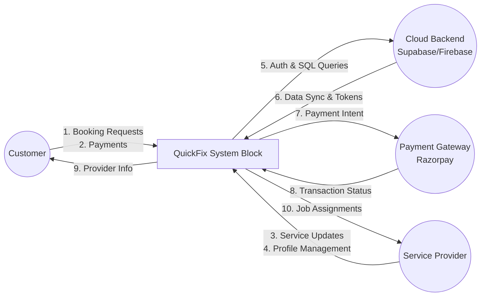
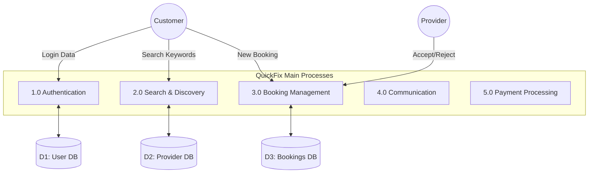
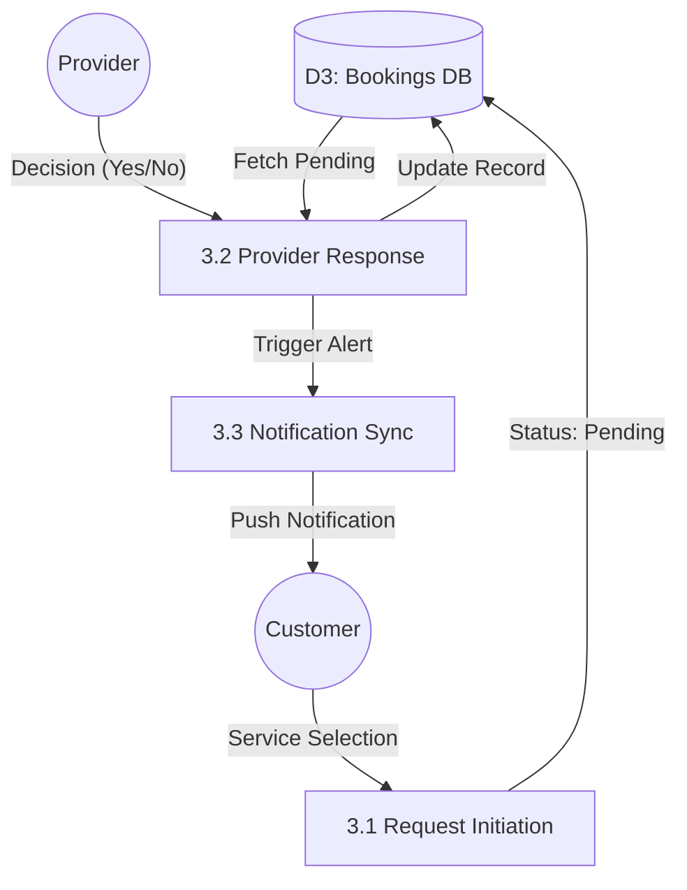
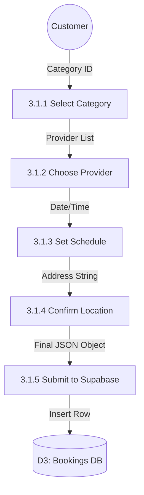

# 3. System Design

## 3.1 Introduction
The System Design phase translates the requirements into a technical blueprint. For the QuickFix project, this involves defining the high-level architecture, identifying the major software components, and mapping the data flow between various actors. The design ensures that the system is scalable, secure, and provides a seamless experience for both customers seeking services and providers offering them.

## 3.2 Assumptions and Constraints
To ensure successful implementation, the following assumptions and constraints are established:
*   **Persistent Connectivity:** It is assumed that users have a stable internet connection (4G/5G/Wi-Fi) to interact with the real-time features of the app.
*   **Third-Party Reliability:** The system relies on the uptime and API stability of Firebase (Authentication/Messaging), Supabase (Database/Storage), and Razorpay (Payments).
*   **Platform Constraint:** The current design is optimized for Android devices running API 24 (Nougat) or higher.
*   **Data Security:** All database interactions are governed by Row Level Security (RLS) policies in Supabase to prevent unauthorized data access.

## 3.3 Functional Decomposition
The QuickFix system is decomposed into specialized functional modules to manage complexity:
1.  **Identity Module:** Handles registration, login, and profile management.
2.  **Discovery Module:** Manages the search engine, filtering of services, and provider listing.
3.  **Transaction Module:** Orchestrates the booking lifecycle from request to completion.
4.  **Notification Module:** Manages real-time alerts and background synchronization.
5.  **Financial Module:** Handles secure payment processing and transaction logging.

## 3.4 Description of Programs

### 3.4.1 Context Flow Diagram (Entities & System Block)
The Context Diagram provides the highest-level view of the system. It identifies the "System Block" (the QuickFix application) and its interaction with "External Entities."

#### Detailed Breakdown of Elements:

| Element Type | Name | Description |
| :--- | :--- | :--- |
| **System Block** | **QuickFix System** | The central Android application that processes user inputs, coordinates with backend services, and manages the local UI state. |
| **External Entity** | **Customer** | The end-user who searches for services, books appointments, and makes payments. |
| **External Entity** | **Service Provider** | The professional (plumber, electrician, etc.) who accepts jobs and manages their business profile. |
| **External Entity** | **Cloud Backend** | A hybrid infrastructure using **Firebase** for identity/messaging and **Supabase** for relational data and object storage. |
| **External Entity** | **Payment Gateway** | The **Razorpay** platform which handles sensitive credit card/UPI data and returns payment success/failure tokens. |

### 3.4.2 Data Flow Diagrams (Level 0, 1, 2)

#### Level 0 DFD: System Overview
Describes how data flows between the primary processes and data stores.

#### Level 1 DFD: Booking Management Lifecycle
Focuses on the data transformations within the "3.0 Booking Management" process.

#### Level 2 DFD: Request Initiation Granularity
Details the specific data inputs required to create a valid booking record.

## 3.5 Description of Components

### 3.5.1 Functional Component 1: Authentication
This component manages the security perimeter. It uses **Firebase Auth** for token-based authentication. Upon a successful login, it retrieves a JWT (JSON Web Token) which is then used to authenticate requests to the Supabase database. This ensures that a user can only read or write their own specific data.

### 3.5.2 Functional Component 2: Search & Discovery
This module implements a dynamic filtering system. It fetches provider data from the `profiles` table in Supabase, filtering by `service_category` and `is_verified` status. It handles the display of star ratings and service descriptions to help users make informed choices.

### 3.5.3 Functional Component 3: Booking Management
The core state machine of the application. It handles transitions: 
*   `PENDING` -> `ACCEPTED` (Provider accepts)
*   `ACCEPTED` -> `COMPLETED` (Job finished)
*   `PENDING/ACCEPTED` -> `CANCELLED` (User/Provider cancels)
It also manages the feedback loop where users submit reviews after a completed service.

### 3.5.4 Functional Component 4: Communication (Real-time)
Utilizes **Firebase Cloud Messaging (FCM)**. When a booking status changes in the database, a background service (or Edge Function) triggers a push notification to the relevant party's device via the `FcmNotificationHelper` class, ensuring users are alerted even if the app is in the background.

### 3.5.5 Functional Component 5: Payment Processing
A secure bridge to the **Razorpay SDK**. It generates a unique `order_id` for every transaction. Once the payment is captured by Razorpay, the component receives a `payment_id` and `signature`, which are verified before updating the booking record's payment status to `PAID`.
